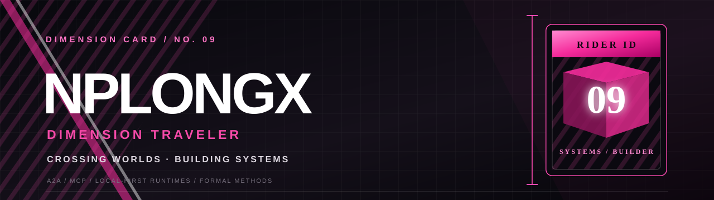

  
   
  <h1>LONG NGUYEN</h1>
  
<strong>DIMENSION TRAVELER · SYSTEMS BUILDER</strong>

  
Building systems that connect agents, tools, workflows, and machines.

  

    
    
  

---

## `01` / PROFILE

I work across application, infrastructure, and automation layers. Current interests sit around **agent orchestration**, **local-first runtimes**, **durable workflows**, and **distributed-system correctness**.

- Designing agent-to-agent workflows and MCP-connected systems.
- Building local-first services with explicit state, persistence, and recovery behavior.
- Exploring browser automation, resource lifecycle, and multi-account boundaries.
- Using formal methods to reason about concurrency, safety, and failure cases.
- Started from IoT and embedded systems; still interested in software that reaches the physical world.

## `02` / CURRENT QUEST

| Dimension | Focus |
|:--|:--|
| Agent systems | A2A communication, orchestration, worker lifecycle |
| Runtime design | Local-first architecture, durable execution, SQLite |
| Integration | Model Context Protocol (MCP), browser automation |
| Correctness | Alloy, Petri nets, temporal logic, state-machine modeling |

## `03` / SELECTED WORLDS

<table>
  <tr>
    <td width="50%" valign="top">
      <strong><a href="https://github.com/nplongx/runalith">RUNALITH</a></strong> 
      Local-first MCP runtime for durable, approval-gated agent workflows.
    </td>
    <td width="50%" valign="top">
      <strong><a href="https://github.com/nplongx/cos-multi-account-mcp">COS MULTI-ACCOUNT</a></strong> 
      Multi-account ContextForge MCP gateway, security boundaries, and operational runbooks.
    </td>
  </tr>
  <tr>
    <td width="50%" valign="top">
      <strong><a href="https://github.com/nplongx/chat-on-steroids">CHAT ON STEROIDS</a></strong> 
      Local MCP capabilities for ChatGPT, browser integration, and multi-agent workflows.
    </td>
    <td width="50%" valign="top">
      <strong><a href="https://github.com/nplongx/workflow-runtime">WORKFLOW RUNTIME</a></strong> 
      Local-first SQLite-backed durable workflow runtime.
    </td>
  </tr>
  <tr>
    <td width="50%" valign="top">
      <strong><a href="https://github.com/nplongx/durable-a2a-mailbox">DURABLE A2A MAILBOX</a></strong> 
      SQLite-backed durable A2A mailbox library with host-supplied authentication.
    </td>
    <td width="50%" valign="top">
      <strong><a href="https://github.com/nplongx/linux-workload-guard">LINUX WORKLOAD GUARD</a></strong> 
      CPU and resource guard for Linux/systemd workloads.
    </td>
  </tr>
</table>

## `04` / TECH DECK

  
  
  
  
  
  
  
  

## `05` / SIGNAL

  
  

---

  <strong>世界をつなぐ。システムを創る。</strong> 
  CROSSING WORLDS · BUILDING SYSTEMS

